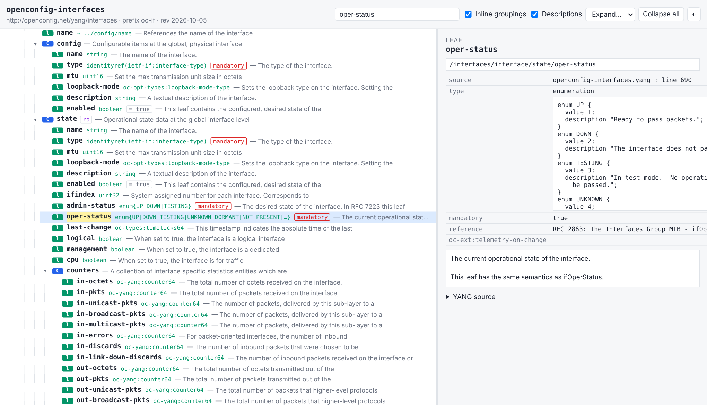

# YANG Tree View: Notepad++ plugin

[](https://github.com/rogersacchelli/YangTreeView/actions/workflows/build.yml)
[](LICENSE)

Read YANG modules (RFC 6020 / RFC 7950) the way you think about them: as a tree.
Press **Ctrl+Alt+Y** in Notepad++ to open an interactive, collapsible tree of the
current module in a panel docked next to your code (or in your browser). Groupings are
filled in from imports and submodules, and there's search, schema paths, and a details pane.



- **No runtime needed.** It's a native, statically linked DLL (x64, x86, ARM64) with no
  Python, .NET or VC++ redistributable required.
- **Unsaved edits included.** It reads the text straight from the editor.
- **Groupings resolved** across `uses`, submodules (`include`) and imported modules.
- **Syntax highlighting** for `.yang` files with one click, in light or dark colours to
  match Notepad++.
- **Fast.** OpenConfig `network-instance` (680+ groupings, 60 files) renders in about 30 ms.

## Install

**Plugins Admin** (once listed): *Plugins → Plugins Admin → search "YANG Tree View" → Install*.

**Manual:** download `YangTreeView-<version>-<arch>.zip` from
[Releases](https://github.com/rogersacchelli/YangTreeView/releases). *? → About Notepad++*
shows whether you need x64 or x86. Unzip it into `Notepad++\plugins\YangTreeView\`,
so the path is `plugins\YangTreeView\YangTreeView.dll`, then restart Notepad++.

## Use

| Plugins → YANG Tree View → | |
|---|---|
| **Show YANG tree** `Ctrl+Alt+Y` | Render the active tab in the docked *YANG Tree View* panel (or the browser, see below) |
| **Show YANG tree in browser** | Render the active tab and open it in the default browser |
| **Use docked panel** ✓ | Off: *Show YANG tree* opens the browser, as in 1.0 |
| **Panel follows active tab** ✓ | Off: the panel only changes when you press `Ctrl+Alt+Y` |
| **Install YANG syntax highlighting** | Adds colouring and `{ }` folding for `.yang` files (restart Notepad++ afterwards) |
| **Search paths and settings...** | Opens `YangTreeView.ini`: one folder per line, searched recursively for imported modules, plus the two settings above |
| **About** | Version info |

- **Finding imported modules:** the plugin looks for `name.yang` or `name@revision.yang`
  (newest revision wins) in the current file's folder (3 levels deep), the folders listed
  in *Search paths*, and the `YANG_MODPATH` environment variable (`;`-separated).
- **Settings** live in the same `YangTreeView.ini` as `panel=docked|browser` and
  `follow=yes|no`. The menu ticks write them; if you edit the file, saving it in Notepad++
  applies them.
- **Syntax errors:** a message box describes the problem and the cursor jumps to the line.
- **Docked panel:** drag its caption to dock it on another side or float it; close it with
  its ✕. It reopens at startup if it was open when Notepad++ closed. The panel uses the
  Microsoft Edge WebView2 Runtime (part of Windows 11, installed on most Windows 10 PCs by
  Windows Update); without it, the tree opens in the browser instead.
  - In a narrow panel the details pane moves under the tree.
  - Colours follow Notepad++'s dark mode, also when you switch it while the panel is open.
  - **↗** opens the same tree in your browser; **Esc** returns to the editor;
    **Ctrl+Alt+Y** (or whatever Shortcut Mapper assigns) refreshes it from inside the panel.
  - **Jump to source:** in the details pane, click *file : line* (or a grouping's line) to
    open that file at that line, including submodules and imported modules.
  - **Stays up to date:** while the panel is visible it refreshes when you save and follows
    you to another `.yang` tab (*Panel follows active tab*). Expanded nodes, selection and scroll position are kept per
    module. A syntax error doesn't interrupt you: the last good tree stays, with a red note.
  - **NETCONF requests:** see below.

### NETCONF request builder (docked panel)
Select a node and open the **NETCONF** section of the details pane:

- **Operation:** `get-config`, `edit-config`, `get` for data nodes (`get` only for
  `config false` data), `rpc` for RPCs and `action` for actions. `get-config` and
  `edit-config` take a datastore (running, candidate; startup for `get-config`);
  `edit-config` takes merge, replace, create, delete or remove.
- **Fields from the model:** one per list key on the way to the node, and, for
  `edit-config`, the node's leaves (for RPCs and actions, the input leaves). Enums,
  booleans and identityrefs are lists; ranges, lengths, patterns, decimals and mandatory
  leaves are checked as you type. Empty fields aren't sent; empty keys in a `get` select
  all entries.
- **Namespaces** come from the model, including nodes added to other modules by
  `augment` (e.g. `/if:interfaces/if:interface`, with its `name` key).
- **Open in new tab** puts the request in a new Notepad++ document (XML); **Copy** copies it.

The builder writes requests; it doesn't connect to devices. Use your NETCONF client to send
them. It doesn't evaluate `when` / `must`, check leafref targets, or apply deviations and
refines.

### Viewer
- **Navigate:** ▸ / ▾, double-click, or the keyboard (↑ ↓ → ← Enter).
- **Inline groupings:** on shows the data tree as in `pyang -f tree`; off shows `uses` nodes
  you can open.
- **Expand to level:** 1–5 or All.
- **Search:** a name or `/regex/`; click a result to jump to it.
- **Details pane:** schema path (click to copy), source file and line, origin module,
  every property, the full description, and the node's YANG text.
- **Badges:** type or leafref target, `[key]`, `ro` (config false), `mandatory`,
  `= default`, units, `[min..max]`, `?feature`, `when`, `must`, `deprecated` / `obsolete`.
- **Theme:** ◐ toggles light and dark (in the docked panel, until Notepad++ switches its own mode).

## Command-line tool

`yang2html-cli-<version>-<arch>.zip` contains `yang2html.exe`, the same engine without
Notepad++:

```
yang2html.exe module.yang [-p C:\yang\models]... [-o out.html] [--open]
```

## Building

**Visual Studio 2019+ / CMake** (static CRT):

```
cmake -B build -A x64    && cmake --build build --config Release
cmake -B build -A Win32  && cmake --build build --config Release
cmake -B build -A ARM64  && cmake --build build --config Release
tests\run_selftest.bat build\Release\YangTreeView.dll build\Release\fakehost.exe
```

CMake downloads the WebView2 SDK (NuGet `Microsoft.Web.WebView2`, hash-checked) at configure
time and links its static loader, so the plugin is still a single DLL. Offline:
`-DWEBVIEW2_DIR=<extracted package>`.

**MinGW-w64** (Linux/WSL/MSYS2): `./build.sh` builds static x64 and x86 binaries in `dist/`.
MinGW can't use the static WebView2 loader, so these builds need `WebView2Loader.dll`
(copied to `dist/<arch>/YangTreeView/`) next to the plugin.

**NETCONF builder test** (Linux/WSL with `node` and `yanglint`):
`tests/run_netconf_test.sh <yang2html>`. It renders the samples as the panel gets them
(`yang2html --host-data`) and validates every generated request against the models.

**Self-test with the real WebView2** (needs a desktop session): set
`YANGTREEVIEW_HEADLESS=1` and `YANGTREEVIEW_SELFTEST_WEBVIEW=1` before `run_selftest.bat`;
the fake host shows the panel in a window and waits for the page to load
(`YANGTREEVIEW_SELFTEST_HOLD=<ms>` keeps it open; `YANGTREEVIEW_SELFTEST_START_TIMEOUT=<ms>`
forces the WebView2 start-up timeout to test the browser fallback).

| Path | What |
|---|---|
| `src/yang_core.*` | YANG tokenizer, parser, module loader, grouping resolution, JSON |
| `src/plugin.cpp` | Notepad++ plugin interface and menu commands |
| `src/dock_panel.*` | Docked panel: Notepad++ docking + WebView2 host |
| `src/viewer_template.html` | Viewer UI; run `python tools/gen_template.py` after editing it |
| `tools/gen_udl.py` | Generates the syntax-highlighting definitions (`udl/`, `src/udl_xml.h`) |
| `tests/fakehost.cpp` | Fake Notepad++ host that drives the DLL through the plugin ABI (run in CI) |
| `tests/run_netconf_test.sh` | NETCONF builder test: generated requests validated with `yanglint` (run in CI, Linux) |

**Releasing:** bump `src/version.h` (and `CHANGELOG.md`) and push to `main`. When that
version has no release yet, CI builds every architecture, runs the self-test, creates the
tag `vX.Y.Z` and publishes a release with the zips, their SHA-256 hashes and ready-to-paste
[nppPluginList](https://github.com/notepad-plus-plus/nppPluginList) entries.

## Limitations

`refine`, augments inside `uses`, `deviation`, and augments that come from *other*
modules are listed as statements but not applied to the tree.

## License

GPL-3.0. See [LICENSE](LICENSE).
